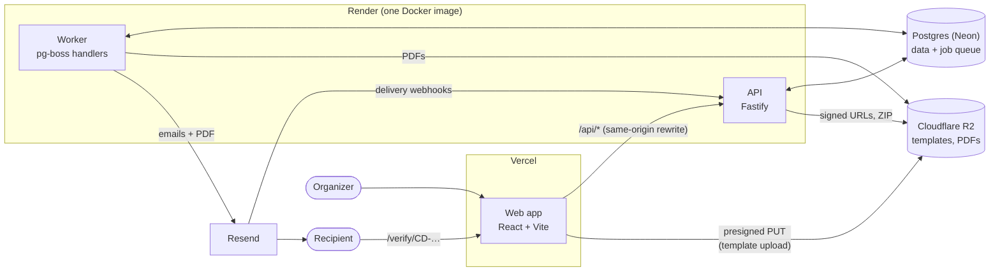
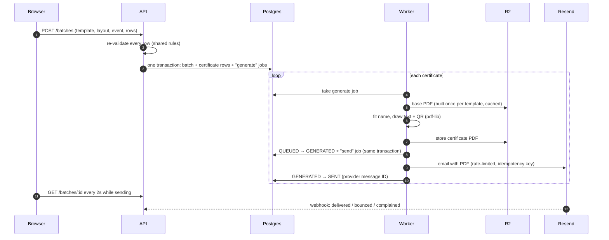

# CertDrop

Upload a CSV and a certificate design. Every participant gets a personalized PDF certificate in their
inbox, with a public verification link and QR code that anyone can check.

- **Passwordless organizers.** Email one-time code, Cloudflare Turnstile, no accounts to manage.
- **Visual layout editor.** Drag a name box onto your PNG, JPG or PDF design. A live preview shows
  how the longest real name will fit, using the same layout code as the PDF renderer.
- **CSV that forgives real exports.** Column detection ("Full Name", "E-mail Address", first + last
  name), row validation, inline fixes and duplicate detection.
- **Background generation and sending.** A separate worker renders PDFs and emails them at a safe
  rate, with retries, live progress, "Retry failed" and a streamed ZIP download.
- **Public verification.** `/verify/CD-…` confirms a certificate, or reports it revoked, without
  exposing anyone's email address.

## Contents

- [How it works](#how-it-works)
- [Local development](#local-development)
- [Environment variables](#environment-variables)
- [Testing](#testing)
- [Deployment](#deployment)
- [Design decisions and trade-offs](#design-decisions-and-trade-offs)
- [Security](#security)
- [Known limitations](#known-limitations)

## How it works



A batch, step by step:



Certificates move `QUEUED → GENERATED → SENT`, or to `FAILED` with the reason and the stage that
failed. "Retry failed" re-runs only that stage. A failed email reuses the stored PDF.

### Repository layout

```
apps/
  web/               React + Vite: the four-step wizard and the public /verify page
    src/features/      auth, template (editor), participants (CSV), send (progress), wizard
  api/               Fastify API (src/server.ts) and pg-boss worker (src/worker.ts), one image
    src/modules/       auth, templates, batches, verify, webhooks (routes + logic)
    src/jobs/          certificate generate/send processors, retention cleanup, queues
    src/pdf/           renderer, fonts, QR code
    prisma/            schema and migrations
    test/              unit/ and integration/ (real Postgres + RustFS)
packages/shared/     Zod schemas and pure logic used by both sides
  src/                 fit algorithm, CSV detection/validation, layout, font coverage
  fonts/               OFL fonts used by both the preview and the PDF renderer
e2e/                 Playwright happy-path test
seed/                sample template (PDF) and participants CSV with deliberate problems
```

## Local development

Requirements: Node 22.12+ (24 recommended), pnpm 10, Docker.

```bash
pnpm install
cp apps/api/.env.example apps/api/.env
cp apps/web/.env.example apps/web/.env
pnpm bootstrap   # Postgres + RustFS, migrations, bucket with CORS
pnpm dev         # web http://localhost:5173, API :3000 and worker, together
```

Emails are not sent locally. The file provider writes each one to `apps/api/.mail-outbox/`, as
`message.json` plus `message.html` and any attached PDF. Sign-in codes are in the subject line.

To try it, sign in with any address and use `seed/sample-template.pdf` and
`seed/sample-participants.csv`. The CSV has 10 valid rows and 4 that need fixing: an empty name, a
bad email, a duplicate and an unsupported script.

| Command                                      | What it does                                                  |
| -------------------------------------------- | ------------------------------------------------------------- |
| `pnpm dev`                                   | Web, API and worker with reload                               |
| `pnpm lint` / `pnpm format:check`            | ESLint (type-aware) / Prettier                                |
| `pnpm typecheck`                             | Strict TypeScript for every package, the e2e test and configs |
| `pnpm test`                                  | Unit and integration tests (needs `pnpm bootstrap` running)   |
| `pnpm test:e2e`                              | Playwright happy path (starts `pnpm dev` if it isn't running) |
| `pnpm build`                                 | API/worker bundle (tsup) and web build                        |
| `pnpm --filter @certdrop/web preview`        | Production build with the production security headers         |
| `pnpm --filter @certdrop/api cleanup`        | Run the retention cleanup now (the worker runs it daily)      |
| `pnpm seed:template`                         | Regenerate `seed/sample-template.pdf`                         |
| `pnpm --filter @certdrop/api fonts:coverage` | Regenerate the font coverage table after changing a font      |

Local object storage is [RustFS](https://github.com/rustfs/rustfs), an Apache-2.0 S3-compatible
server. MinIO stopped publishing community Docker images in 2025. The app only speaks the S3 API,
so production uses Cloudflare R2 with no code changes.

## Environment variables

All API variables are validated at startup (`apps/api/src/config/env.ts`). A missing or malformed
value stops the process with the variable's name, never its value. `apps/api/.env.example` has
working local defaults.

| Variable                                                                            | Required      | Purpose                                                                            |
| ----------------------------------------------------------------------------------- | ------------- | ---------------------------------------------------------------------------------- |
| `PUBLIC_APP_URL`                                                                    | yes           | Web app origin; verify links and QR codes point here                               |
| `DATABASE_URL`                                                                      | yes           | Postgres. On Neon, use the direct (non-pooled) URL: pg-boss needs session features |
| `S3_ENDPOINT`, `S3_REGION`, `S3_BUCKET`, `S3_ACCESS_KEY_ID`, `S3_SECRET_ACCESS_KEY` | yes           | R2 / RustFS. `S3_FORCE_PATH_STYLE=true` for RustFS                                 |
| `SESSION_SECRET`, `OTP_SECRET`                                                      | yes           | ≥32 characters each; separate so either can be rotated alone                       |
| `EMAIL_PROVIDER`                                                                    |               | `file` (default, local) or `resend` (required in production)                       |
| `RESEND_API_KEY`, `EMAIL_FROM_ADDRESS`                                              | with Resend   | API key and a sender on your verified domain                                       |
| `RESEND_WEBHOOK_SECRET`                                                             |               | `whsec_…`; enables delivery/bounce tracking                                        |
| `TURNSTILE_SECRET_KEY`                                                              | in production | Cloudflare Turnstile secret                                                        |
| `CORS_ORIGINS`                                                                      |               | Extra browser origins for API CORS and bucket upload CORS                          |
| `TRUST_PROXY_HOPS`                                                                  |               | Proxies in front of the API (2 for Vercel → Render), so rate limits see real IPs   |
| `EMAIL_RATE_PER_SECOND`                                                             |               | Default 2 (Resend's default limit)                                                 |
| `GENERATE_CONCURRENCY`                                                              |               | Parallel PDF renders per worker (default 3)                                        |
| `BATCHES_PER_DAY`, `TEMPLATES_PER_DAY`                                              |               | Per-organizer caps per rolling 24 h (10 / 30)                                      |
| `FILE_RETENTION_DAYS`                                                               |               | Days before templates and PDFs are deleted (30)                                    |
| `FONTS_DIR`                                                                         |               | Font directory; set to `/app/fonts` in the Docker image                            |

Web (`apps/web/.env`, or Vercel's environment variables):

| Variable                  | Purpose                                                                |
| ------------------------- | ---------------------------------------------------------------------- |
| `VITE_TURNSTILE_SITE_KEY` | Turnstile site key. The example uses Cloudflare's always-pass test key |

## Testing

| Layer                                                      | What it covers                                                                                                                                                                                                                                                                                                                                                                     |
| ---------------------------------------------------------- | ---------------------------------------------------------------------------------------------------------------------------------------------------------------------------------------------------------------------------------------------------------------------------------------------------------------------------------------------------------------------------------- |
| Unit (`packages/shared`, `apps/api/test/unit`, `apps/web`) | Name fitting and wrapping, CSV column detection and validation, formula stripping, certificate IDs, template inspection (magic bytes, decompression-bomb guard, EXIF rotation, PDF checks), PDF rendering read back as text with pdf.js, QR codes decoded with jsQR, webhook signatures against Svix's documented example, font metrics and coverage checked against the TTF files |
| Integration (`apps/api/test/integration`)                  | Real Postgres and RustFS: OTP sign-in (expiry, lockout, races, cooldowns, IP limits), presigned uploads, **the full batch pipeline with a real pg-boss worker and emails written to disk**, retries, ZIP, verification and revocation, quotas, Turnstile, webhooks, retention cleanup, and a check that logs never contain addresses or codes                                      |
| End-to-end (`e2e/`)                                        | Playwright: sign in → template → CSV → send → recipient verifies, failing on any Content-Security-Policy violation. `E2E_BASE_URL=http://localhost:4173 pnpm test:e2e` runs it against the production build with production headers                                                                                                                                                |

CI (`.github/workflows/ci.yml`) runs lint, format, typecheck, all tests and builds on every PR,
with Postgres and RustFS as service containers. It also runs the Playwright test against the full
stack and checks that the Docker image builds.

## Deployment

The target setup is the web app on **Vercel**, the API and worker on **Render** (two services from one
image), **Neon** Postgres, **Cloudflare R2** and **Resend**.

1. **Neon:** create a project and copy the _direct_ connection string.
2. **Cloudflare R2:** create a bucket and an API token with object read/write. The S3 endpoint is
   `https://<account-id>.r2.cloudflarestorage.com`. Allow browser uploads from your web origin
   with either of these:
   - Run `pnpm --filter @certdrop/api storage:init` once with the production values in
     `apps/api/.env` (it applies the CORS rules).
   - Paste this into the bucket's CORS settings:
     `[{"AllowedOrigins":["https://YOUR-APP.vercel.app"],"AllowedMethods":["PUT"],"AllowedHeaders":["content-type"],"MaxAgeSeconds":3600}]`
3. **Resend:** verify your sending domain and create an API key. Add a webhook to
   `https://YOUR-APP.vercel.app/api/webhooks/resend` for `email.delivered`, `email.bounced` and
   `email.complained`, and copy its signing secret.
4. **Turnstile:** add a site for your Vercel domain. The site key goes to Vercel, the secret to
   Render.
5. **Render:** New → Blueprint → this repository. `render.yaml` creates `certdrop-api` (health
   check `/api/health`, migrations as a pre-deploy step) and `certdrop-worker`. Fill in the
   prompted values; the session and OTP secrets are generated for you.
6. **Vercel:** import the repository with **Root Directory `apps/web`**. Set
   `VITE_TURNSTILE_SITE_KEY`. In `apps/web/vercel.json`, change the `/api` rewrite destination to
   your Render API URL (Vercel can't read environment variables there).
7. **Check:** `https://YOUR-APP.vercel.app/api/health` reports `ok`. Then send a one-row batch to
   yourself and open the QR code with your phone.

## Design decisions and trade-offs

**pg-boss instead of Redis + BullMQ.** The job queue lives in the Postgres the app already uses,
so there's one less service to run and pay for. It also allows **transactional enqueueing**: a
batch, its certificate rows and its jobs are written in one transaction (pg-boss inserts through
the Prisma transaction), so a batch can never exist without its jobs. The cost is lower peak
throughput than Redis, which doesn't matter at 1,000 certificates per batch, where the email rate
limit is the bottleneck anyway.

**Presigned uploads with a "complete" step.** Templates go from the browser straight to R2, so
10 MB files never pass through the API. The signature pins the exact `Content-Length` and type,
and storage rejects anything else. R2 doesn't support presigned POST policies, so after upload
the API inspects the file: magic bytes, image dimensions read from the header before any decoding
(a decompression-bomb guard), EXIF rotation, and PDF page count, encryption and rotation. Only
then can a template be used.

**Same-origin API.** Vercel rewrites `/api/*` to Render, and Vite's dev proxy does the same
locally. The session cookie is therefore first-party everywhere and can be
`HttpOnly; Secure; SameSite=Strict; Path=/api`, with no CORS configuration for the app itself.

**Passwordless, stateless sessions.** A 6-digit code, stored only as an HMAC bound to the email,
expires in 10 minutes, works once, and locks after 5 wrong guesses. The attempt counter is
incremented atomically, so parallel guesses can't race past the limit. Sessions are short (2-hour)
signed JWTs with no session table.

**One fit algorithm for preview and PDF.** `packages/shared/src/fit.ts` shrinks a name to 60% of
the chosen size, then wraps it onto two balanced lines. It runs in the browser (measuring with
canvas) and in the worker (measuring with pdf-lib), with the same TTF files and with font metrics
stored in code, so the preview matches the certificate.

**Font fallback per word, decided by a generated table.** Browsers can't tell which glyphs a
font has. `fonts:coverage` generates a table of missing characters from the font files, and a
test fails if it drifts. Both sides use it to switch whole words to Noto Sans. Switching per
character would mix typefaces inside a word: Playfair Display has π but no other Greek letters.

**Fonts embedded whole.** pdf-lib's font subsetting corrupted glyphs in testing (Inter), so
fonts are embedded unsubsetted. PDFs are about 0.3–0.6 MB instead of about 50 KB. Correctness
won, and the renderer tests read every certificate's text back to catch regressions.

**Two queues with idempotent steps.** Separate generate and send queues mean a failed email
doesn't re-render the PDF, and each stage has its own concurrency and backoff. pg-boss delivers
at least once, so every state change is conditional (`WHERE status = 'QUEUED'`), and sends carry
an idempotency key. A handler records the error and completes on its final attempt, or straight
away for permanent errors such as a provider 4xx. The worker never crashes on a bad row.

**Derived counts, polling progress.** Batch counts come from a `GROUP BY` over at most 1,000
indexed rows, so they can't drift under concurrent workers. Progress polls every 2 seconds and
stops when the batch finishes. Server-sent events would need fan-out from the worker to the API
for no visible benefit at this scale.

**Layered abuse prevention.** Because the app sends email for strangers, several layers stack:

- Turnstile before any code is sent. It fails closed and is required in production.
- Per-IP rate limits on every write route.
- Per-email OTP cooldowns and an hourly cap.
- Per-organizer daily caps on batches and uploads.
- At most 1,000 rows per batch.
- Every email names the issuer and the event, and replies go to the organizer, so recipients know
  exactly who contacted them.

**Data minimization.** Generated PDFs and templates are deleted after 30 days by a daily
pg-boss cron. Certificate rows stay, so verification links keep working for good. Revoked
certificates stop showing the recipient's name. Logs mask email addresses, and a test asserts
that the sign-in flow never logs an address or a code.

**Frontend weight.** The template editor (Konva, pdf.js), the CSV step and the verify page load
lazily. Animation code loads after first paint. I measured splitting vendor libraries into
separate chunks and dropped it: it made the first load about 10 KB larger. The main bundle is
about 139 KB gzipped.

**Versions.** Prisma stays on 6.x: version 7's generated-client and driver-adapter changes add
nothing here. TypeScript stays on 6.0, the newest version typescript-eslint supports.

## Security

- `@fastify/helmet` headers on the API. The web app sends a strict Content-Security-Policy
  (`apps/web/vercel.json`) that allows only itself, Cloudflare Turnstile and direct R2 uploads.
  `vite preview` serves the same headers, and the e2e test fails on any CSP violation.
- JSON-only request bodies (the `text/plain` parser is removed) with a 1 MB limit.
- Zod validation on every input, shared with the frontend.
- CSV formula injection (`= + - @`) is stripped before anything is stored or emailed.
- Signed, short-lived URLs for every download. Buckets are never public.
- Webhooks are verified with the Svix scheme: HMAC over the raw body, constant-time comparison,
  a 5-minute replay window and key rotation.
- Secrets live only in environment variables. Production refuses to start with the file email
  provider or without Turnstile.

## Known limitations

- **Scripts:** Latin (including Vietnamese), Greek and Cyrillic names are supported. pdf-lib
  doesn't shape text, so Arabic, Devanagari, Thai and similar scripts would render incorrectly.
  Those rows are flagged instead. Chinese, Japanese and Korean would need a large extra font.
- **Single instance:** rate-limit counters are in memory, which is correct for one API instance.
  Running several needs a shared store. The email rate limit applies per worker process.
- **Image size:** the API/worker image is about 850 MB, mostly Prisma's client, engines and the
  CLI used for migrations. A separate migration image or Prisma's engine-free client would roughly
  halve it.
- **No dashboard:** the organizer's draft lives in the browser tab. Past batches aren't listed after
  a reload, though their certificates stay verifiable.

Fonts are under the SIL Open Font License; see `packages/shared/fonts/licenses/`.
